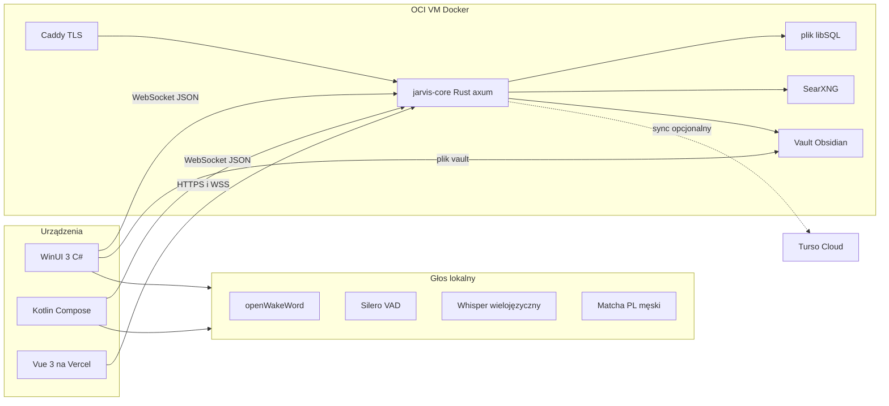

# Jarvis Agent

Pusty katalog [JarvisAgent](c:\Users\jakub\Desktop\MyProjects\JarvisAgent). Rust jest tylko mózgiem na serwerze. Desktop i telefon to osobne aplikacje natywne, spięte tym samym kontraktem JSON po WebSocket. Tauri i Capacitor odpadają. Vue zostaje wyłącznie jako czat w przeglądarce.

## Decyzje (negocjacja)

**Rust tylko w backendzie.** `apps/core` na OCI: HTTP, WebSocket, providerzy, pamięć, narzędzia po stronie serwera. Na PC i telefonie nie ma procesu Rusta, webview ani hosta Tauri.

**Desktop: WinUI 3 + C# (Windows App SDK).** Windows jest Twoim systemem, a WinUI 3 jest jego aktualnym natywnym UI: okna przezroczyste i zawsze na wierzchu, kompozycja paneli HUD, skróty globalne, zasobnik, bezpośredni dostęp do UI Automation, zrzutu ekranu (`Windows.Graphics.Capture`) i powiadomień. Sterowanie komputerem siedzi w tym samym procesie co HUD, bez mostka do webview. Qt byłby jednym C++ na kilka systemów i odsunąłby integrację z Windows. .NET MAUI i Flutter to znowu wspólna warstwa UI, czyli ten sam kompromis co Tauri.

**Mobile: Kotlin + Jetpack Compose.** Natywny Android: powiadomienia, lokalizacja, SMS, media i usługa dostępności bez WebView. Mapa przez MapLibre Native (OpenGL), głos przez oficjalny pakiet sherpa-onnx na Androida. iOS (SwiftUI) ewentualnie później i okrojony: głos, czat, HUD, lokalizacja, bez sterowania ekranem innych aplikacji.

**Web: Vue 3 na Vercel, dwie osobne strony.** Statyczny build Vite (`apps/web`) idzie na Vercel. Czat (`/`) ma te same możliwości co rozmowa głosowa: te same narzędzia, ta sama pamięć, te same widgety HUD i te same reguły obecności. Różnica jest tylko w kanale. Zamiast mikrofonu i głośnika jest pole tekstowe i odpowiedź pisana, strumieniowo, zdanie po zdaniu. Mapa w czacie to MapLibre GL na tym samym payloadzie co Mapsui i MapLibre Native. Potwierdzenie kliknięcia na komputerze albo akcji na telefonie w czacie web jest przyciskiem albo wpisaniem „tak”. Na Windowsie i na Androidzie to samo zadanie da się puścić głosem. Samo wykonanie i tak leci na urządzenie, które umie to zrobić. Panel dev (`/admin`) jest obok, nie wewnątrz czatu. WinUI i Compose nie mają osobnego trybu czatu ani panelu admina. Mózg, terminal i pulpit OCI zostają na VM: Vercel serwuje tylko pliki UI i woła API oraz WebSocket na OCI. Długie sesje terminala i noVNC nie idą przez funkcje Vercel.

**Wejście na web: samo hasło.** Jedno pole, bez maila, numeru, nazwy użytkownika i konta. Hasło siedzi w env serwera OCI jako hash Argon2. Strona logowania jest na Vercel, a sprawdzenie hasła leci do API na OCI. Po zgodności Axum stawia ciasteczko sesji (`HttpOnly`, `Secure`, `SameSite=None`), bo strona i API są na różnych domenach. Przeglądarka wysyła je z `credentials: include`. CORS na OCI puszcza tylko dokładny adres produkcji z Vercel, bez gwiazdki. To samo ciasteczko puszcza czat, admina, terminal i podgląd pulpitu. Złe hasła są ograniczane limitem prób. Aplikacje WinUI i Android dalej wchodzą kodem parowania, nie tym hasłem.

**Głos: tak, i tylko na urządzeniu.** Mikrofon, wybudzenie, VAD, STT i TTS zostają w WinUI i w Androidzie. Fraza „hey jarvis” albo skrót otwiera pływający pasek i od razu strumień mowy. Pierwszy człon odpowiedzi jest czytany, zanim model skończy resztę. Do OCI leci sam tekst.

**Host: Oracle Always Free Ampere A1 (ARM64).** Obraz Dockera budujemy pod `linux/arm64`. VM.Standard.E2.1.Micro (1 GB RAM) tego stosu nie udźwignie.

## Wygląd

Czat web, panel admina, WinUI i Android dostają ten sam język wizualny. Jeden arkusz w `design/tokens.md`: tło, akcent, ostrzeżenie, odstępy, promień, czas ruchu. Implementacje są osobne, liczby są wspólne.

Kierunek to ciemny HUD: prawie czarne tło, jeden cyjan jak reaktor, ciepły bursztyn tylko na ostrzeżenie i zgodę. Ramki cienkie, narożniki z kreskami, panele jak szkło na stałej siatce. Tekst rozmowy jest duży i czytelny. Liczby, status i terminal są pismem o stałej szerokości. Ruch trwa 150–220 ms i nie przesuwa układu.

Każdy ekran ma pięć stanów narysowanych z góry: spoczynek, praca, pusty, błąd, prośba o zgodę. Błąd z mózgu jest kartą z jednym zdaniem, nie zrzutem stosu. Strumień odpowiedzi dopisuje tekst w zarezerwowanym miejscu. Mapa i panele mają stałe sloty, więc nic nie nachodzi na pole wpisu ani na przycisk zgody. Kontrast tekstu trzyma poziom AA. Na webie sprawdzane są szerokości biurka i wąskiego okna: logowanie, wysłanie wiadomości, widget, błąd i powrót do spoczynku.

## Architektura



Jeden mózg, wiele klientów. Sesja żyje na serwerze. Oba klienty rysują ten sam komunikat JSON własnymi kontrolkami.

Obecność jest zawsze na jednym urządzeniu: głos, HUD i rozmowa idą razem. Przy starcie Jarvis oznacza zadanie jako `dowolne` albo `wymaga: komputer` / `wymaga: telefon`. Od tego zależy, co dzieje się, gdy wyjdziesz z telefonem.

- **Zadanie dowolne** (rozmowa, szukanie, pogoda, notatka, mapa). Nie potrzebuje innego urządzenia, więc Jarvis przeskakuje na telefon w całości: ta sama sesja, ten sam wątek, głos i HUD. Komputer milknie i zamyka panele. Nic nie zostaje tam w tle.
- **Zadanie przypięte** („napisz w Rust hello world”, kliknięcie w program, odczyt SMS). Robota zostaje na maszynie, która umie ją zrobić. Na telefon przechodzą głos, HUD i rozmowa, a o sukcesie albo błędzie Jarvis mówi już tam.

Przykład przypięcia: jesteś przy biurku, plik i `cargo` lecą na komputerze. Wychodzisz z telefonem. Program dalej się buduje na komputerze, a telefon mówi i pokazuje kartę „hello world gotowe”.

Przykład pełnego przeskoku: pytasz o pogodę albo każesz pokazać mapę i wychodzisz z telefonem w trakcie odpowiedzi. Jarvis urywa komputer i kończy tę samą sprawę na telefonie, bo do tego komputer nie był potrzebny.

## Przełączanie urządzeń

Komenda „przenieś na telefon” przenosi całą obecność i wygrywa z automatyką. Jarvis podejmuje tę samą decyzję sam, gdy widać, że Ciebie już przy tamtym urządzeniu nie ma.

Każdy klient co kilka sekund przysyła stan: online, mowa, ostatni dotyk albo klik, lokalizacja, bezczynność, możliwości (`sterowanie_pc`, `powiadomienia`, `sms`) oraz telemetrię (CPU, GPU i temperatura tam, gdzie system je podaje, bateria, jakość Wi-Fi albo LTE).

Reguły:

1. **Przypięcie.** „Zostań tutaj” trzyma całą obecność, dopóki nie powiesz „możesz przełączać” albo „przenieś”.
2. **Jesteś tam, gdzie urządzenie, które masz przy sobie.** Telefon opuszcza strefę biurka, a komputer milknie (brak kliknięć i głosu) — obecność przechodzi na telefon w całości. Słowo wybudzenia na danym urządzeniu znaczy to samo: tam jesteś, więc tam jest Jarvis.
3. **Zadanie dowolne przeskakuje w całości.** Gdy nie ma wymagania konkretnego urządzenia, przeniesienie zabiera też wątek: komputer kończy rolę klienta, telefon przejmuje sesję w tym samym miejscu.
4. **Zadanie przypięte zostaje przy maszynie.** Nowe polecenie, które umie wykonać tylko komputer, startuje na komputerze. Wynik, pytanie i błąd wracają jednym komunikatem na aktualną obecność: mowa i karta HUD razem.
5. **Jedna decyzja.** Serwer nie rozdziela głosu, HUD i rozmowy. Model proponuje przeniesienie narzędziem `move_presence` i podaje, czy zadanie jest `dowolne`, czy `przypięte`. Serwer i tak sam to sprawdza po narzędziach użytych w zadaniu i odrzuca przeniesienie, gdy obecność jest przypięta.
6. **Czat web ma ten sam mózg co głos.** Wiadomość z przeglądarki albo „przenieś na czat” przenosi całą obecność na czat: komputer i telefon milkną, a widgety (mapa, notatka, status, wynik zadania) rysują się na stronie czatu. Narzędzia są te same. Zadanie przypięte do komputera albo telefonu dalej wykonuje się tam, a pytanie o zgodę i wynik wracają tekstem do czatu. Wejście na `/admin` obecności nie rusza.

Żeby GPS nie przerzucał Cię w kółko, automat ma odstęp około minuty i próg odległości od biurka. Przy remisie Jarvis zostaje. Zmianę zapisuje w audycie i na nowym urządzeniu mówi już treść sprawy („program gotowy”), a nie osobny komunikat o przełączeniu.

## Backend (Rust)

- Edycja `2024`, tokio 1.54, axum 0.8, serde, tower-http, tracing.
- Axum: REST do parowania urządzeń, WebSocket do rozmowy i HUD, osobny WebSocket terminala PTY. Strony web i ich API wymagają ciasteczka sesji.
- Klucze providerów tylko w env serwera. Klient nigdy ich nie widzi.
- Parowanie: kod jednorazowy, wymiana kluczy publicznych, potem token urządzenia. Klucz prywatny zostaje na urządzeniu.
- Narzędzia jako funkcje z poziomem ryzyka. Odczyt (pogoda, mapa, wyszukiwanie) idzie od razu. Zapis, sterowanie komputerem albo telefonem, shell i skrypt wymagają karty zgody na obecności, z wpisem w audycie. Na Windowsie i na Androidzie zgodę można dać głosem albo przyciskiem. W czacie web zostaje przycisk i wpisanie „tak”. Sterowanie i lokalny shell wykonuje klient natywny. Shell na OCI wykonuje core.
- Narzędzie `move_presence` przenosi głos, HUD i rozmowę razem. Przy zadaniu `dowolne` telefon przejmuje sesję, a poprzedni klient schodzi do zera. Przy zadaniu `przypięte` worker zostaje na maszynie wykonującej. Przypięcie obecności blokuje automat i propozycję modelu.
- Router modeli: trait `LlmProvider`, łańcuch z wyłącznikiem po HTTP 429, wybór po zadaniu (głos → najniższy czas do pierwszego tokenu, wizja i długi kontekst → Gemini).

Kontrakt HUD (serwer wysyła, WinUI i Compose rysują):

```json
{ "type": "map", "center": [19.94, 50.06], "zoom": 4, "layers": ["weather"] }
{ "type": "note", "title": "Przypomnienie", "body": "..." }
```

Schemat trzymamy w `protocol/` (JSON Schema). Rust sprawdza go przy serializacji. C# i Kotlin dostają z niego typy (modele WinUI i `kotlinx.serialization`).

## Szyfrowanie

TLS kończy się na Caddy. Wrażliwa treść jest szyfrowana jeszcze raz, do klucza odbiorcy, więc nie leży jawnie w logu ani w Vercel. Gdy sync Turso jest włączony, w chmurze też ląduje szyfrogram.

Każde urządzenie i core mają parę X25519. Prywatny klucz Windows trzyma DPAPI, Android Keystore, przeglądarka WebCrypto bez możliwości eksportu. Prywatny klucz core leży w pliku na VM, poza repozytorium i poza bazą. Przy parowaniu strony wymieniają się tylko kluczami publicznymi i zapinają je. Od tej chwili notatka, fakt, schowek, zrzut, zdjęcie, skrypt i wynik polecenia idą jako sealed box: jednorazowy klucz AES-GCM zawinięty do klucza publicznego odbiorcy.

Klucze providerów nie jadą na telefon ani na komputer. Na dysku OCI są zaszyfrowane kluczem core. Token urządzenia po parowaniu serwer trzyma jako hash. Audyt zapisuje rodzaj zdarzenia, nie treść notatki i nie sekret.

Vault w Obsidianie zostaje jawny na Twoim dysku, bo tak czyta go aplikacja. Kopia w pliku libSQL jest szyfrogramem. Core odszyfrowuje notatkę w pamięci, gdy buduje embedding albo prompt, i nie zrzuca jej do logu. Odbiorcą jest proces Jarvisa na OCI, nie proxy. Model u providera dostaje fragment promptu, gdy ta ścieżka jest włączona. To wychodzi poza końce Twoich urządzeń.

## Panel admina (web)

Osobna strona `/admin`, ten sam Vue i to samo hasło co czat. To narzędzie developerskie na maszynie OCI, nie kolejny klient Jarvisa i nie urządzenie obecności.

- **Jarvis:** które providery mają klucz (bez pokazywania sekretu), ostatnie błędy 429, urządzenia online, gdzie jest obecność, otwarte zadania, skrót audytu.
- **Flagi funkcji:** osobna karta na `/admin`. Każda funkcja ma przełącznik: głos i fraza wybudzająca, pływający pasek, paleta poleceń, schowek, telemetria i reakcje proaktywne, tryby pulpitu, shell, skrypty tymczasowe, skrót powiadomień, harmonogram, porządkownik notatek, powiązania w vaultcie, graf encji, mapa i szukanie, wzrok ekranu, aparat, strażnik OCI, analizator logów, sync Turso. Stan siedzi w tabeli `feature_flags` w pliku libSQL. Core czyta flagę przed daną ścieżką, więc zmiana działa od razu, bez restartu. Wyłączenie chowa funkcję i odrzuca jej narzędzie. Strona admina i hasło flagą nie są, żeby panel sam siebie nie zamknął.
- **Środowisko:** karta z listą zmiennych Jarvisa. Da się dodać, podmienić i usunąć klucz. Zapis idzie do `data/jarvis.env` na wolumenie, zaszyfrowanego kluczem core, i ten plik jest źródłem po pierwszym zapisie. Sekret (klucz, token, hasło) po zapisie widać tylko jako „ustawione”. Wartość nie wraca do przeglądarki, nie wchodzi do audytu, do logu ani do grafu. Audyt zapisuje samą nazwę zmiennej. Klucze providerów i ścieżki core przeładowuje od razu. Adres nasłuchu wymaga restartu kontenera, a karta to mówi. Zmiana hasła do web kończy pozostałe sesje.
- **Maszyna OCI:** `docker compose ps`, logi kontenerów, restart wybranej usługi, CPU, RAM i dysk VM. Panel steruje hostem, na którym stoi Jarvis. Nie woła API konsoli Oracle Cloud i nie zakłada instancji.
- **Wiersz poleceń:** terminal w przeglądarce, PTY na tej samej VM (`portable-pty` w procesie core), katalog startowy repozytorium deployu. Każda sesja terminala ląduje w audycie. Gniazdo Dockera jest podmontowane do kontenera core, żeby restart usług działał z panelu.
- **Podgląd pulpitu:** gdy po starcie Jarvisa zostaje około 1,5 GB wolnego RAM, na VM wstaje lekki pulpit na wirtualnym ekranie (Xvfb + labwc) i noVNC w `/admin`. Da się klikać i pisać, to nie jest zrzut ekranu. Port VNC słucha tylko na localhost, a przeglądarka dochodzi do niego przez WebSocket sprawdzany tym samym ciasteczkiem hasła. Gdy RAM jest za ciasny, kafelek pulpitu jest wyłączony i zostaje terminal. Podgląd nie jest klientem obecności i nie przejmuje rozmowy.

## Pamięć

Dwa magazyny są od początku: vault Obsidiana i plik libSQL. Baza jest zawsze plikiem otwieranym w procesie `jarvis-core`, bez osobnego serwera SQL. Na dev to `data/jarvis.db`. Na OCI ten sam plik leży na wolumenie Dockera. Sync do Turso Cloud jest na razie opcjonalny i domyślnie wyłączony, także na VM. Włącza go dopiero flaga `turso_sync` razem z adresem i tokenem w env. Bez tego Jarvis do Turso nie dzwoni. Vault jest katalogiem na VM, nie aplikacją Electron. Klient WinUI czyta i zapisuje go przez Syncthing albo git, więc mózg widzi notatki także przy wyłączonym PC, o ile sync zdążył. Na tych magazynach stoją dwie warstwy pamięci i hybrydowe szukanie.

**Krótka.** Aktywna rozmowa siedzi w procesie Rusta: ostatnie tury sesji, ograniczone oknem. Zapis do libSQL jest od razu, więc restart VM nie gubi wątku. Redis odpada przy jednym procesie i jednym użytkowniku. Wróci dopiero, gdy mózg będzie miał więcej niż jedną instancję.

**Długa.** Po turze tani model wyciąga kluczowe fakty (osoba, decyzja, preferencja, data) i odrzuca powtórki hashem. Fakt ląduje w dwóch miejscach: wiersz w libSQL (źródło sesji, encje) oraz notatka Markdown w katalogu `vault/jarvis/pamiec/`, żeby dało się ją czytać w Obsidianie. Reszty vaultu Jarvis sam nie przepisuje.

**Porządkownik.** Surowa myśl, wpisana albo podyktowana, idzie osobną drogą. Jarvis czyta nazwy folderów, które już masz w vaultcie, wybiera jeden, dokłada tagi i frontmatter ze wzoru w `vault/szablony/`, a gdy wzoru nie ma, ze swojego krótkiego szablonu. Plik dostaje tytuł i ląduje w wybranym folderze. Na obecności widać kartę ze ścieżką i tagami, zanim notatka zostanie uznana za gotową, żeby dało się powiedzieć „nie, to do projektów”.

**Powiązania.** Po zapisie nowej notatki albo faktu embedding szuka najbliższych kawałków w vaultcie. Nad progiem podobieństwa Jarvis dopisuje w nowej notatce sekcję `## Powiązania` z linkami `[[tytuł]]`. Starych notatek nie edytuje. Te same linki pokazuje na pasku.

**Graf.** Obok podobieństwa jest graf encji w libSQL. Typy to osoba, projekt, technologia, serwer, zmienna i notatka. Krawędź ma rodzaj: używa, wdrożony na, powiązany z, należy do. Z rozmowy, z notatki i z faktu Jarvis dopisuje węzły i krawędzie, więc da się przejść ścieżkę: projekt X używa Rust, Rust jest wdrożony na OCI, OCI jest powiązane z notatką Y. Pytanie „z czym to się łączy” idzie po krawędziach, a wektor tylko podpowiada brakujące ogniwa. Nazwa zmiennej środowiskowej może być węzłem. Jej wartość nie wchodzi do grafu, do notatki ani do logu. Nakładka dla Ciebie to plik `vault/jarvis/graf.md`, składany z tabel, oraz linki w nowych notatkach. Twoich starych notatek graf nie przepisuje.

**RAG, hybryda.** Każdy plik Markdown jest cięty po nagłówkach. Kawałek dostaje embedding i wpis FTS5 w tym samym libSQL. Pytanie szuka naraz słowami i wektorem, a wyniki scala reciprocal rank fusion. Do promptu wchodzi okno krótkiej pamięci plus kilka trafień z notatek, ze ścieżką pliku. Cały vault do kontekstu nie wchodzi.

Wektory zostają w pliku libSQL, nie w osobnym Qdrant ani LanceDB. Qdrant zjadłby RAM na tej samej VM, na której ma się zmieścić pulpit. LanceDB byłby drugim silnikiem obok pliku, który i tak jest bazą. Rozszerzenie wektorowe libSQL trzyma FTS, fakty, graf i wektory w jednym pliku. Gdy kiedyś włączysz sync, ten sam plik pojedzie do Turso. Embeddingi liczy lokalny model ONNX, wielojęzyczny, na CPU VM, więc treść notatek nie idzie do Gemini tylko po to, żeby je zindeksować.

## Głos i pływający HUD

Ten sam potok w WinUI i na Androidzie. Wybudzenie, VAD i STT idą przez sherpa-onnx. Mowa idzie przez ONNX Runtime i model Matcha po polsku, nie przez Piper. Żadnego sidecaru w Rust. Do OCI leci sam tekst.

**Hands-free.** W tle słychać tylko frazę „hey jarvis” (openWakeWord). Surowy mikrofon zostaje na urządzeniu. Po frazie od razu otwiera się kanał: VAD, strumień STT i pływający pasek. To samo robi skrót globalny na Windowsie. Wybudzenie ustawia obecność na to urządzenie.

**Mowa.** VAD to Silero, z przerwaniem (barge-in), gdy zaczniesz mówić w trakcie odpowiedzi. STT to Whisper wielojęzyczny, rozmowa po polsku. Głos to Matcha-TTS-PL-Edge-v2, męski `male_voxcpm_2`, z losowym czasem trwania głosek, więc rytm nie jest metronomem. Na Windowsie model idzie w fp32 i czterech krokach. Na telefonie ten sam głos w int8 i dwóch krokach, strumieniowo. Angielskie wstawki w zdaniu są czytane po angielsku. Tokeny z modelu lecą strumieniem. Pierwsze zdanie albo człon do przecinka idzie do syntezy, zanim model skończy resztę, i od razu wchodzi na głośnik. Kolejne człony ustawiają się w kolejce odtwarzania. Gdy głos się nie wczyta, pasek zostaje przy tekście. Nie ma zapasowego, płaskiego syntezatora.

**Pasek.** Na WinUI i na Androidzie jest minimalne okno zawsze nad innymi aplikacjami: cienki pasek statusu, nie pełny ekran. Widać na nim stan (słucham, myślę, mówię) i jeden widget na żywo, na przykład baterię albo skrót odpowiedzi. Fraza albo przychodzący widget go rozwija. Po chwili bezczynności wraca do paska. Większa mapa i karta zgody otwierają się pod paskiem, na tym samym urządzeniu. Czat web rysuje te same widgety na stronie, bez pływającego okna nad systemem.

**Zgoda głosem.** Gdy karta zgody jest otwarta, Jarvis mówi jedno zdanie, co wykona, i od razu słucha, bez drugiej frazy „hey jarvis”. „Tak”, „potwierdź” albo „wykonaj” puszcza to zadanie. „Nie” albo „anuluj” je kasuje. Inna mowa nie jest zgodą. Okno słuchania jest krótkie i dotyczy tylko tej karty. Przycisk na karcie robi to samo. Audyt zapisuje, że zgodę dano głosem albo przyciskiem.

**Paleta.** Na Windowsie główne wejście z klawiatury to paleta w stylu Spotlight. Domyślny skrót to Alt+Space i da się go zmienić, bo ten sam skrót otwiera menu okna. Paleta jest osobna od paska: pole na środku ekranu, wyniki pod spodem, obsługa strzałkami i Enterem. Z jednego pola idzie szukanie notatek Obsidiana (hybryda FTS i wektorów na OCI), uruchomienie aplikacji, polecenie do Jarvisa tą samą sesją co głos i czat, oraz stan systemu i serwera. Ręce zostają na klawiaturze.

Podpowiedzi układają się same, zanim cokolwiek wpiszesz. WinUI podaje porę dnia i to, jakie okno jest na wierzchu. Rano i przy otwartym IDE na górze jest „Skompiluj projekt”. Wieczorem „Otwórz notatnik codzienny”. „Pokaż status serwera” zostaje pod ręką, gdy strażnik OCI ma coś do powiedzenia. Enter uruchamia podświetloną pozycję. Sama podpowiedź nic nie wykonuje.

## Providerzy AI (darmowi)

Wszyscy za adapterem w stylu OpenAI, z łańcuchem awaryjnym. Limity free zmieniają się co kilka tygodni — router ma być listą w konfiguracji, nie zahardkodowaną kolejnością w kodzie.

Rdzeń, od razu:

- **Groq** — najszybszy czas do pierwszego tokenu, najlepszy pod głos. Darmowy plan, weryfikacja telefonu, limity na organizację (ok. 30 żądań/min i 1000/dzień na modelach open-weight; stan X 2026).
- **Google Gemini (AI Studio)** — Flash / Flash-Lite: długi kontekst, narzędzia, obraz. Najlepsza jakość w free. Uwaga prywatności: na darmowym planie Google może używać promptów do ulepszania produktów; od marca 2026 płatny plan jest wymagany, jeśli API obsługuje końcowych użytkowników z EOG. Osobisty asystent dla Ciebie samego mieści się w użyciu własnym, ale klucza nie wolno wkładać w aplikację oddawaną innym osobom.
- **OpenRouter `:free`** — jeden klucz, rotująca pula modeli. Niski dzienny limit (rząd 20/min i 50/dzień). Zapas, nie silnik główny. Regulamin zabrania odsprzedaży dostępu.

Zapasowe wtyczki (włączane kluczem, ten sam interfejs):

- **Cloudflare Workers AI** — ok. 10 000 neuronów/dzień; słabsze modele, inny kształt API.
- **Mistral La Plateforme** — tryb Free do prototypu; domyślnie mogą uczyć się na danych, jest opt-out w panelu.
- **SambaNova** — darmowy przydział na większych Llama, limity dzienne, traktować jako opcjonalny.
- **Z.ai (GLM Flash)** — modele Flash oficjalnie za 0 USD; zapas gdy Groq i Gemini utną limit.
- **Cohere** — trial rzędu 1000 wywołań/miesiąc, tylko do testów, nie do codziennej rozmowy.

Świadomie poza routerem:

- **Cerebras** — od października 2026 to trial z kartą (5 USD / 30 dni), nie stały free.
- **GitHub Models** — wyłączone 30 lipca 2026.
- **Ollama na Twoim PC** — nie provider, tylko lokalna deska ratunkowa gdy wszystkie limity padną i masz GPU. Mózg na OCI woła endpoint, który wskażesz (tunel z desktopu).

## Narzędzia i HUD

- **Szukanie:** SearXNG w tym samym `docker-compose` (bez klucza API). Wynik wraca jako widget notatki.
- **Mapa świata:** ten sam payload, kafelki OSM, warstwy na żądanie (pogoda z Open-Meteo, lokalizacja, pinezki z notatek). Windows: Mapsui. Android: MapLibre Native. Czat web: MapLibre GL. „Na żywo” = odświeżanie warstwy, nie jeden feed całej planety.
- **Komputer (WinUI):** zrzut ekranu, skróty, uruchamianie aplikacji, układ okien według trybu, schowek. Kliknięcia i wpisywanie przez UI Automation tylko po potwierdzeniu.
- **Telefon (Kotlin):** powiadomienia, lokalizacja, media, latarka, udostępnianie, telemetria i schowek tekstowy. Sterowanie innymi aplikacjami przez usługę dostępności, też po potwierdzeniu.
- **HUD:** pływający pasek nad aplikacjami na WinUI i Androidzie oraz te same widgety na stronie czatu. Przy głosie pasek rozwija się razem z mową. Pierwsze treści: stan nasłuchu, telemetria, skrót odpowiedzi, a po rozwinięciu mapa, notatka, karta wyniku i karta zgody. WinUI, Compose i Vue rysują jeden payload.
- **Obecność:** klient wysyła stan (mowa, dotyk, bezczynność, lokalizacja, telemetria, możliwości). Serwer trzyma „gdzie jest użytkownik”. Zadanie dowolne przeskakuje na telefon w całości. Zadanie przypięte zostaje na maszynie wykonującej, a sukces idzie tam, gdzie jest użytkownik.

## Zmysł urządzeń

WinUI i Android zbierają telemetrię w tle i rysują ją na własnym dashboardzie. Te same liczby idą do Rusta przy takcie obecności. GPU i temperatura pojawiają się tylko wtedy, gdy system je wystawia. Puste pole zostaje puste.

Reakcja proaktywna jest regułą w Rust, nie zgadywaniem modelu przy każdej próbce. Przykład: bateria laptopa spada do 12 procent, a w pamięci długiej jest sesja za około 20 minut. Jarvis mówi to raz, na aktualnej obecności, i milknie do naładowania albo do końca sesji. Źródłem „sesji” jest fakt zapisany wcześniej w `vault/jarvis/pamiec/` albo wprost w rozmowie, nie osobny kalendarz.

**Tryby pulpitu** są tylko na Windowsie. Tryb to zapis w libSQL: które aplikacje otworzyć, jak ułożyć okna, co zrobić z powiadomieniami. „Tryb kodowanie” otwiera Cursor, terminal i Spotify i układa okna. „Tryb nauka” włącza skupienie (cisza powiadomień) i otwiera Obsidian. Układ okien robi WinUI (`MoveWindow` po starcie procesów). Zmiana trybu idzie głosem albo tekstem i jest zadaniem przypiętym do komputera.

**Schowek** synchronizuje tekst i kod między Windows a Androidem po tym samym WebSocket. Obrazki i pliki nie idą. Każdy wpis ma urządzenie źródła i skrót, więc telefon nie odsyła z powrotem tego, co właśnie wstawił. Rust odrzuca treść, która wygląda na sekret: klucz, hasło, ciąg o wysokiej entropii. Zwykły fragment kodu przechodzi. „Nie synchronizuj schowka” wyłącza tor do odwołania.

## Silnik działań

**Shell.** Narzędzie `shell` ma cel `oci` albo `windows`. Na OCI core uruchamia polecenie jako użytkownik usługi, w katalogu deployu. Na Windowsie polecenie wykonuje WinUI na sparowanym komputerze. Android powłoki nie dostaje. To osobna ścieżka od interaktywnego terminala w `/admin`: agent nie pisze w otwartym PTY, tylko wysyła jedno polecenie. Zanim cokolwiek ruszy, obecność pokazuje kartę z dokładną komendą i celem. Zgodę dajesz głosem albo przyciskiem. Po wykonaniu karta dostaje skrócony stdout, kod wyjścia i limit czasu. Wpis ląduje w audycie. Stąd Jarvis buduje projekt, sprawdza `docker compose ps` i restartuje usługę, zawsze po Twojej zgodzie.

**Skrypt na żądanie.** Gdy przeliczenie, konwersja pliku albo przegląd katalogu nie mieści się w jednej komendzie, model pisze krótki skrypt: PowerShell albo Python na Windowsie, Bash albo Python na OCI. Plik powstaje w katalogu tymczasowym, z losową nazwą, i jest wykonywany raz. Karta zgody pokazuje całą treść skryptu, interpreter i katalog roboczy. Po zakończeniu plik jest kasowany, zostaje skrócony wynik i wpis w audycie. Skrypt nie dostaje podniesionych uprawnień i nie jest zapisywany do repozytorium ani do vaultu. Android skryptów nie uruchamia.

**Skrót powiadomień.** WinUI (nasłuch powiadomień Windows) i Android (usługa powiadomień) przysyłają aplikację, tytuł i krótki fragment. Rust składa z tego paczkę, a tani model zostawia tylko sprawy ważne: ludzie, terminy, alarmy. Reklamy i powtórki odpadają. Skrót wraca kartą HUD na obecności i krótkim powiadomieniem systemowym. W trybie nauka paczka czeka do końca trybu i wychodzi raz.

**Harmonogram.** W core działa planista na tokio. To jedna funkcja, z flagą w panelu. Co ma robić i o której godzinie, ustala się w rozmowie z Jarvisem, głosem albo tekstem. Zadanie ląduje w libSQL: nazwa, cron, strefa Europe/Warsaw i treść, którą Jarvis ma wykonać tą samą sesją co zwykłe polecenie. Restart VM listy nie gubi. Wyłączenie flagi wstrzymuje odpalanie, nie kasuje zadań. Gdy w chwili odpalenia żadne urządzenie nie słucha, wynik czeka i wychodzi przy najbliższym połączeniu. Jeśli zadanie ma coś zapisać, notatka i tak powstaje w vaultcie.

## Wzrok

Jarvis widzi, co robisz na sparowanym Windowsie i Androidzie. Zna aplikację i okno na wierzchu, a gdy obraz się zmienia albo potrzebuje tego do bieżącej rozmowy, bierze krótkie spojrzenie na ekran. Spojrzenia nie składają się w nagranie i nie idą do vaultu. Aparat nie patrzy w pokój sam z siebie.

Na prośbę robi zrzut albo zdjęcie sam, bez skrótu z Twojej strony, i oddaje obraz modelowi z widzeniem. Odpowiedź wchodzi na pasek i do mowy od pierwszego członu. Skrót na Windowsie zostaje, gdy chcesz wskazać prostokąt. Zrzut ekranu nie zostaje w vaultcie, chyba że poprosisz, żeby go zapisać. Zdjęcie rzeczy, tabliczki albo dokumentu, które kazałeś zrobić, ląduje ze syntezą w `vault/jarvis/wzrok/` i dostaje powiązania. Pasek pokazuje ścieżkę. Flaga wzroku wyłącza i spojrzenia, i zdjęcia na prośbę.

## Strażnik OCI

Core co kilkadziesiąt sekund sprawdza kontenery projektu, RAM VM i procesy usług. Jeśli w konfiguracji jest tunel Cloudflare albo DuckDNS, sprawdza też, czy nazwa odpowiada i czy publiczny adres Jarvisa odpowiada. To dopisek do Caddy, nie zamiana wejścia.

Padnięty kontener z tego compose core podnosi sam, najwyżej trzy razy na godzinę na usługę. Po trzecim razie przestaje i wysyła na telefon ciche powiadomienie, bez głosu. Ten sam cichy push idzie po udanym restarcie. Własnego procesu core nie restartuje od środka. Do tego jest polityka `restart` w Dockerze, a po wstaniu core dopisuje informację do tego pusha.

**Logi.** Core czyta logi swoich usług na bieżąco. Panic albo odpowiedź 500 uruchamia analizę stacktrace przez model. Wynik to propozycja poprawki w `vault/jarvis/naprawy/` i karta na telefonie. Poprawka nie jest wdrażana ani commitowana.

## Układ repozytorium

- `apps/core` — jedyny Rust: axum, providerzy, narzędzia serwerowe, plik libSQL. Sync Turso jest opcją, domyślnie wyłączoną.
- `apps/desktop` — WinUI 3, C#, Windows App SDK, głos i sterowanie PC
- `apps/mobile` — Android, Kotlin, Jetpack Compose
- `apps/web` — Vue 3 na Vercel: `/` czat, `/admin` dev tools, `/login` samo hasło. `VITE_API_URL` wskazuje Caddy na OCI.
- `deploy/Dockerfile`, `deploy/docker-compose.yml` — core, Caddy (tylko API i WebSocket), SearXNG, wolumen z plikiem libSQL i vaultem. Na dev core łączy się z `data/jarvis.db` bez tego compose.
- `protocol/` — JSON Schema zdarzeń
- `design/tokens.md` — wspólne kolory, typografia, odstępy i stany ekranu

## Fazy

1. Szkielet: cargo edition 2024, axum health, Dockerfile ARM64, compose z Caddy i wolumenem. Baza dev to plik `data/jarvis.db`.
2. Router Groq + Gemini + OpenRouter z fallbackiem na 429, WebSocket sesji i sealed box na notatki, schowek, obrazy i wyniki poleceń.
3. Czat web (Vue 3) na Vercel i bramka hasła na OCI, od razu na tokenach HUD. Te same narzędzia, widgety i reguły obecności co głos; odpowiedź tekstem. Logowanie to jedno pole hasła. Stany: spoczynek, praca, pusty, błąd, zgoda.
4. Panel `/admin` w tym samym języku wizualnym: flagi funkcji, karta środowiska (`data/jarvis.env`, sekrety zamaskowane), status Jarvisa, kontenery i zasoby VM, terminal PTY na OCI. Przy zapasie RAM także używalny pulpit noVNC. Wejście na admina nie przejmuje obecności.
5. Pamięć: skrót sesji w Rust i w pliku libSQL, fakty do `vault/jarvis/pamiec/`, klasyfikacja surowych myśli do folderów vaultu ze szablonem i tagami, graf encji (osoba, projekt, technologia, serwer, zmienna, notatka) w libSQL i nakładka `vault/jarvis/graf.md`, embeddingi ONNX, hybryda FTS5 i wektorów. Sync Turso zostaje wyłączony, dopóki nie włączysz flagi i tokenu. Wartości zmiennych środowiskowych do grafu nie wchodzą.
6. WinUI 3: parowanie, fraza „hey jarvis”, pływający pasek nad aplikacjami, paleta Alt+Space z podpowiedziami od pory dnia i aktywnego okna, TTS od pierwszego członu odpowiedzi, dashboard telemetrii. Czat i admin zostają tylko w przeglądarce.
7. Widget mapy (Mapsui) i status urządzeń. Wyjście z telefonem poza biurko: zadanie dowolne (mapa, rozmowa, szukanie, także wątek rozpoczęty w czacie web) przeskakuje na telefon w całości; hello world w Rust dalej buduje się na PC, a o sukcesie Jarvis mówi na telefonie.
8. Narzędzia Windows: UI Automation z potwierdzeniem, tryby pulpitu (kodowanie, nauka), SearXNG.
9. Android (Compose): fraza wybudzająca, pływający pasek, TTS od pierwszego członu, telemetria, powiadomienia i lokalizacja, to samo parowanie.
10. Schowek tekstowy Windows-Android przez WebSocket, z filtrem sekretów, oraz reguła proaktywna (niska bateria i zbliżająca się sesja z pamięci).
11. Silnik shell i skrypty tymczasowe: PowerShell albo Python na Windowsie, Bash albo Python na OCI. Karta zgody z pełną treścią, zgoda głosem albo przyciskiem, jeden bieg, kasowanie pliku, audyt. Android bez powłoki i bez skryptów.
12. Skrót powiadomień z Windows i Androida oraz harmonogram: puste zadania, treść i godziny powstają w rozmowie z Jarvisem i siedzą w libSQL.
13. Wzrok: Jarvis widzi bieżącą pracę na Windowsie i Androidzie. Na prośbę sam robi zrzut albo zdjęcie i je analizuje. Zdjęcie rzeczy trafia do `vault/jarvis/wzrok/`.
14. Strażnik OCI: kontenery, RAM, tunel Cloudflare albo DuckDNS, restart do trzech razy na godzinę, cichy push. Przy panic i 500 propozycja poprawki w `vault/jarvis/naprawy/`, bez wdrażania.
